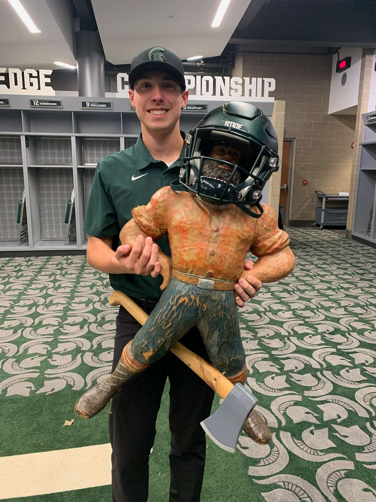

My background connects measurement technology from Kistler, football operations at MSU, and independent baseball research. I currently work in eCommerce management at CMI Corp.; this page covers the work behind my portfolio. 

---

## Biomechanics & Performance Science

**Kistler Instrument Corp.** | 2022 - 2026

I spent four years at Kistler, starting in Industrial Production before moving into the biomechanics Application Specialist role in 2023. 
I worked with MLB, NBA, NHL, and NFL teams, as well as a wide variety of university research labs and performance facilities. 
As the sole executor of North American operations, I owned everything from application design and system integration 
to on-site installations, conferences, and marketing.

A few highlights:

- **System validation**: When our largest research client had lost confidence after months of unresolved issues, I worked with our technical lead in Germany to measure natural frequency at each layer (building foundation, force plates, top plates) using accelerometers and FFT analysis. That showed exactly where the system stood and turned the relationship into a collaboration on test design. The next year, I led troubleshooting on one of their other installations myself.
- **Sport-specific system development**: Led project design for instrumented pitcher's mounds and batter's boxes, working through the engineering and measurement challenges unique to baseball applications.
- **Motion capture integration**: Diagnosed and resolved interface issues between force plates and optical tracking systems.
- **Performance testing workflows**: Helped performance scientists design and troubleshoot testing protocols, with an emphasis on data quality and repeatability.

---

## Michigan State University Football

**Student Equipment Manager** | 2018 - 2021

  
  
Paul Bunyan Trophy, 2021

Before Kistler, I spent four years earning my Applied Engineering Sciences degree and working as a student equipment manager for the football program, finishing as Head Student Manager in my final season.

On any given day, I coordinated across coaching staff, strength and conditioning, athletic training, nutrition, operations, and video- each with their own priorities, terminology, and constraints. My job was to make sure nothing fell through the cracks.

In that final season, I served as an on-field assistant to the head coach and led the student staff. As the man on the microphone directing traffic every practice, I quickly learned to be decisive and get comfortable with sudden change. It pushed me to find a clear, confident voice and move on from mistakes immediately- because there's no hiding when the whole program is relying on you for direction.

Across those four seasons, I supported teams that played in the Redbox Bowl (2018), Pinstripe Bowl (2019), and Peach Bowl (2021).

---

## Independent Research

Since 2023, I've maintained an independent focus on baseball analytics and biomechanics, primarily using publicly available data from Statcast and FanGraphs, plus video I capture myself. I pursue questions that interest me, often building the necessary technical skills in real time.

A few areas I've been working on:

1. **[Markerless pitching biomechanics](https://ryanliam-bio.github.io/baseball_analytics/projects/opensim-v3/)**: smartphone video → RTMPose → OpenSim inverse kinematics and joint torque modeling.
2. **[Bat tracking](https://ryanliam-bio.github.io/baseball_analytics/projects/bat-speed-three/)**: contact-point-adjusted bat speed, and how quickly swing metrics stabilize.
3. **[Bayesian projection](https://ryanliam-bio.github.io/baseball_analytics/projects/bayesian_mcmc_2026/)**: hierarchical R/Stan run-scoring model for team win totals.
4. **[Swing-change detection](https://ryanliam-bio.github.io/baseball_analytics/projects/stance-tracker/)**: changepoint tracking of daily Statcast stance and swing-trait data.
5. **[Market-based evaluation](https://ryanliam-bio.github.io/baseball_analytics/projects/awards-audit-2026/)**: midseason MVP, Cy Young, and Rookie of the Year market analysis, audited against final results.

I treat this site as a working archive- everything can be found on the [Projects](https://ryanliam-bio.github.io/baseball_analytics/projects/) page.

---

<a href="Liam-Ryan-Resume.pdf" download class="btn btn-primary">
Download Resume (PDF)
</a>

---

## Education

**Michigan State University** | Bachelor of Science, Applied Engineering Sciences | December 2021
- Concentration in Supply Chain Management

---

## Technical Skills

| Category | Tools & Methods |
|----------|-----------------|
| Programming | Python, R, SQL |
| Statistical modeling | Bayesian hierarchical models (Stan), changepoint detection, XGBoost / random forests |
| Computer vision and biomechanics | RTMPose pose estimation, OpenCV stereo calibration and triangulation, OpenSim inverse kinematics and joint kinetics |
| Measurement hardware | Force plate installation, synchronization, and vibration diagnostics; motion capture integration; instrumented mounds and batter's boxes |
| Data | Statcast (pitch and bat tracking), FanGraphs, Driveline OpenBiomechanics |

