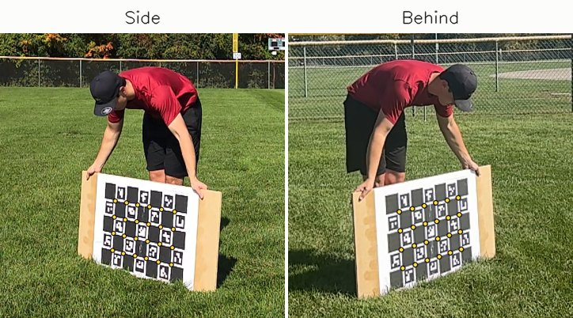
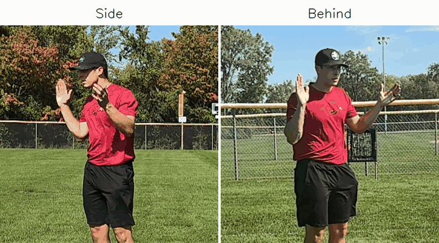
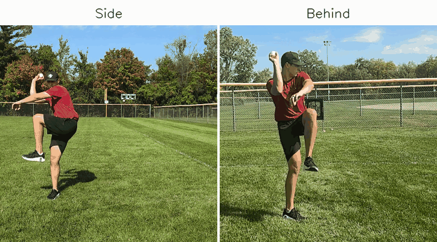
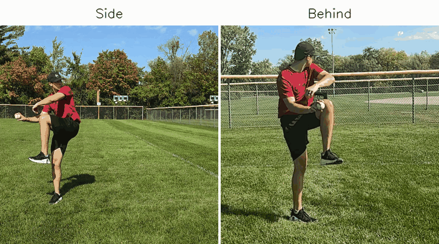
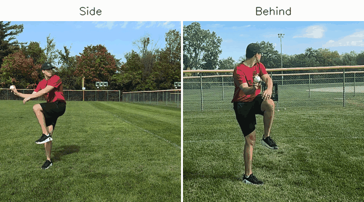

> [!abstract] Summary
> Delivering on the promised follow-up of [2.0](https://ryanliam-bio.github.io/baseball_analytics/projects/opensim/), pipeline 2.1 adds and synchronizes a second phone. With that, we now have real depth and a more legitimate 
> foundation for analyzing the biomechanical metrics that actually matter, namely elbow varus torque. Of course, this analysis still needs asterisks all throughout
> for several reasons- first and foremost being that the camera stands we used were cheap enough to shift throughout acquisition as a result
> of high winds that day. I was able to apply frame-by-frame corrections using background fence and tree lines to get us to sensible numbers, but
> that leaves us still needing a heavy grain of salt on our computed ~63 mph velocity and ~128 N·m elbow torque. Understanding there's a low ceiling to
> the meaningful analysis we can do on a foundation of two phone cameras, a good chunk of this page will be focused on what I can do next round to 
> squeeze a little more statistical juice out of this project.

### Overview

I threw 13 full-effort pitches over three clips with the S26 side-on from my arm side and the iPhone behind the rubber (shaded slightly toward my arm side), both ~15 ft from the mound,
~21.5 ft apart, at about rib height.

Same 7×5 ChArUco board as 2.0 but closer sweeps and more tilt this time; focal length came out within ±0.40% on the S26 and ±0.55% on the iPhone vs ~1% for 2.0.

That previously mentioned crossfire tendency leaked through more in this session and I generally feel a bit short on the stride, but the lead leg block felt a little better. 
Just trying to put the pieces together one by one.

*The calibration board from both phones at the same moment, with the detected corners marked*

---

### What to Expect From This Data

Before any numbers, this project needs a major disclaimer. Basically nothing worked as built on the first pass:
- both phones moved in the wind, so every frame had to be registered back to the calibration
- the iPhone quietly drops a third of its slow-mo frames
- the two clocks only lined up to within a few ms after pooling all the throws in each clip
- MediaPipe's landmarks make my arm shorter than a tape measure does (forearm by ~2 cm, upper arm by ~4 cm), worth ~25% of my elbow torque, so torque runs on a model arm scaled from my height, which lands close to the tape

Each of those was corrected in some way and checked against an independent benchmark (tape measure, my height, and Driveline's own data), but every correction 
invariably creates some additional error in our calculations and 13 throws is still a relatively small sample.

With that in mind, I've constructed some rough plausible ranges for each number we obtained from this analysis:

| Number | Value (median) | Plausible range | Confidence | Limiting factor |
| --- | --- | --- | --- | --- |
| Release speed | 63.4 mph | 61–66 | Fairly good | 11 tracked throws; calibration scale (±3.5%) |
| Elbow varus torque | 128 N·m | 110–140 | Rough | filter cutoff (−15% to +7% on the median), which encloses throw-to-throw uncertainty (95% confidence interval, or CI, of 121–136) and the landmark arm path (−11%) |
| Shoulder internal rotation torque | 130 N·m | 110–140 | Rough | same as above |
| Torque relative to velocity (vs Driveline, in standard deviations) | +2.2 SD | +0.9 to +3.0 SD | Direction only | above typical in every version I ran, but extrapolating below Driveline's slowest pitch (69.5 mph) |
| Layback (max shoulder external rotation), elbow extension velocity, trunk tilt, and arm slot | see below | — | Consistency only | good throw-to-throw precision, unverified absolute accuracy from two phones |
| Hip-shoulder separation, front knee angle, and shoulder internal rotation velocity | not reported | — | None | front leg partially obstructed; too noisy |

As you can see our takeaways are pretty limited, but I'm reasonably confident in the velocity numbers and my elbow torque sitting inside Driveline's
range (toward the top), albeit above typical for my velocity. This is a meaningful improvement over 2.0 (duh) despite plenty of meat left on the bone, 
which I'll try to detail more fully in [What's Next](#whats-next-22).

---

### Getting Two Phones to Agree

*The clap that starts each clip, synced (4x slow motion)*

Even with a significantly improved process, few things went smoothly:
- **Wind.** I did not account for the potential of a windy day when buying Walmart phone tripods. Both phones slowly tilted over the session- the S26 by ~25 px before I 
even started throwing (~35 px by the fifth throw).
Calibration necessitates a static camera position, so every frame now gets registered back to a reference frame from the calibration clip using 
the background (trees, fence, and light poles). With that, the phones triangulate at 15.7 and 14.7 ft from where I stood (tape: ~15) and 21.4 ft from each other (tape: 21.5).
It's data standard butchery, but it salvaged otherwise unusable recordings.
- **iPhone slo-mo.** It records on a 240 Hz clock but only keeps ~162 frames a second (mostly alternating 4 ms and 8 ms gaps). The timestamps check out, 
so the pipeline now handles uneven frame spacing instead of treating every 8 ms gap as a dropped frame.
- **Sync.** The clap gets the two clips close and the remaining gap is largely eliminated by matching my throwing arm during each delivery. 
All throws in a clip share one offset, and in the first two clips they agree to ~1–2 ms (well under a 4 ms frame). The last clip's clap was faint- two of its three throws agree within ~3 ms and the third
was 12 ms off, so that clip's offset comes from the two that agree.

---

### Elbow and Shoulder Torque

This is the number the original 1.0 pipeline (recapped on the [2.0 page](https://ryanliam-bio.github.io/baseball_analytics/projects/opensim/)) was built to chase. Two models split the work here: OpenSim gives the actual torque, and a simpler model handles the comparisons against Driveline
since it's the only one I can run the exact same way on their data and mine.

**What "elbow varus torque" means here.** In late cocking, the trunk and shoulder rotate forward while the forearm and ball lag behind, which tries to open the elbow on its inside (valgus). Elbow varus
torque is the net internal moment resisting that, shared by the UCL, the flexor-pronator muscles, and the bony joint itself.
Here it's the moment the upper arm applies to the forearm and hand about the elbow center, taken about the axis perpendicular
to the forearm in the plane of the arm, read as the peak between 40 ms before and 20 ms after max layback, and reported in absolute N·m (not normalized to body size), the same way Driveline reports it.

**OpenSim.** I scaled the Rajagopal model to my height and weight, placed its markers from a 3D T-pose, smoothed the triangulated markers at Driveline's 20 Hz, and ran inverse kinematics (IK) on all 13 throws.
Elbow varus (as defined above) comes from OpenSim's own segment masses and inertias; the model's elbow is a hinge, so its built-in inverse dynamics can't output varus directly. Median: 128 N·m.

**A simple model.** Elbow varus only depends on what the forearm and hand are doing, so I also built a forearm-and-hand model from just the shoulder, elbow, and wrist positions, with standard segment masses
(de Leva) and the same filter and window, run on OpenSim's joint centers (whose 28 cm forearm matches my tape). I ran the identical model on Driveline's own joint centers for all 403 OpenBiomechanics Project (OBP) pitches: it tracks their published elbow
varus at r = 0.87 (reading ~9% low) and shoulder internal rotation torque at r = 0.87 (~10% low). Not perfect, but consistently a bit low rather than randomly off.

When fed the same arm motion, OpenSim reads 1.13x the simple model on average (1.08–1.18, r = 0.97), right in line with the ~1.10x Driveline's own data predicts. So the two agree and OpenSim's numbers
land on essentially the same scale as Driveline's published ones.

The one real disagreement left is where exactly my arm's joints are placed. Along with how much the data get smoothed, it's one of the two biggest sources of uncertainty in the torque (~10%
each). MediaPipe's landmarks put my upper arm at 27 cm, while a tape measure (~35 cm from the top of my shoulder, so ~30–32 cm joint to joint) sides more with OpenSim's 32 (Driveline's joint centers average ~34 at my height). Everything here uses OpenSim's fitted
arm. Using MediaPipe's landmark positions instead (with the forearm still stretched to tape length), the torque comes out ~11% lower, which still lands inside the range below (the filter choice sets its ends).

| | Median (n=13) | Plausible range | Driveline's pitchers (middle 80%) | Vs. Driveline pitchers at my velocity + size |
| --- | --- | --- | --- | --- |
| Elbow varus (late cocking) | **128 N·m** | 110–140 | 88–135 N·m | +2.2 SD above expected (range: +0.9 to +3.0) |
| Shoulder internal rotation | **130 N·m** | 110–140 | 83–131 N·m | +2.8 SD above expected (range: +0.5 to +3.8) |

The last column uses the simple model, run identically on Driveline's 403 pitches and my 13 throws. My torque is 2.2 standard deviations higher than they'd predict 
for a 63 mph / 195 lb pitcher. It holds up to the 
filter choice too- rerun at every cutoff from 12 to 25 Hz (identically on both sides), I land between +0.9 and +2.7 SD.
Individual throws ran 103–158 N·m.

Drawing conclusions, I'd say my elbow load sits within, but toward the top end of, the range Driveline's pitchers produce, which is the main 
thing I wanted to know after my bicep strain in June.
Relative to my velocity, every version I ran (both arm definitions, every filter) puts my elbow torque consistently above Driveline's prediction, 
so I'm comfortable calling it higher than typical. How far above is much less
clear, for two reasons. First, I'm not a Driveline-level pitcher. At ~63 mph I'm about 6 ticks below their slowest recorded throw (69.5), so the 
prediction itself is an extrapolation. Second, a pair of everyday smartphones on tripods (with the associated motion blur, video compression, sway corrections,
few ms of sync error, etc.) leaves considerably more high-frequency noise in the tracked arm than a lab-grade mocap setup would. All that gets picked up in a peak torque number, 
so my numbers climb faster than Driveline's as the filter loosens. With a stricter 13 Hz filter on
both sides I'm still above typical, but closer to +1 SD than +2. Despite the inherent limitations, this is the number I'm most curious about 
long-term as I continue to build toward next season.

---

### The Delivery

*Throw 5: 65.0 mph, 128 N·m (the session median), 4x slow motion*

| Metric (13 throws) | Median | Spread (SD) |
| --- | --- | --- |
| Release speed (11 tracked) | 63.4 mph | ±2.0 |
| Max external rotation (layback) | 150° | ±4.1° |
| Elbow extension velocity | 1,705 °/s | ±101 |
| Peak wrist speed | 16.0 m/s | ±0.3 |
| Trunk forward tilt at release | 23° | ±2.6° |
| Arm slot at release | 47° | ±6.6° |

Velocity comes from a 3D fit of the ball's flight through both views (best: 65.2 mph on throw 4). Max layback landed between 142° and 158° on every throw, which is by design- this delivery is built to get
my arm to the same set position (cocked behind my head, elbow high) so velocity comes from rotation rather than pulling my arm across my body with my bicep, which is what strained it in June. These are to be taken as a
baseline for my own sessions rather than a ranking against Driveline, since MediaPipe's landmarks and Driveline's marker-based model don't define joint angles quite the same way.

Two side notes from 2.0: its single-camera ball-as-ruler method reads ~16% fast on these clips, and the promised one-phone vs two-phone check came back about as expected (the S26 alone matches trunk tilt
within ~1° but reads wrist speed ~20% high, and anything needing depth is noise).

---

### What's Next: 2.2

Re-shooting the week of Oct 19. Every change is aimed at one of the shortcomings outlined in [What to Expect](#what-to-expect-from-this-data):
- **Measure my upper arm properly** (shoulder width, plus a second set of hands on the tape) and scale OpenSim's arm to it segment by segment instead of from my height. The arm path and the filter choice are the two biggest pieces of the torque range (~10% each), and a properly sized arm should help both, since a better IK fit leaves less jitter to smooth
- **More throws, 25–30 instead of 13.** Throw-to-throw spread is the next biggest piece. More throws won't shrink the spread itself, but doubling them should cut the uncertainty on the median by roughly a quarter to a third (the 95% CI goes from ~121–136 to about ±5 N·m)
- **Secure the stands and keep the board in view of both phones** during throws, so frame-by-frame corrections have a more reliable foundation and the calibration can be re-checked at any point in the session
- **Get my front foot visible to both phones at foot plant** (raise the side phone and angle it slightly down, or add a third if I can borrow one), so stride, front knee, and timing stop depending on one angle. Bonus: it lets the one-phone vs two-phone check cover those too
- **Give the S26 more room for ball tracking in frame, and use clean balls.** The ball leaves its frame ~70 ms after release, and our tracking missed the ball entirely on 2 of 13 throws (buying an assorted box of baseballs off Facebook marketplace isn't guaranteed to give pearls). More flight in frame would allow the 3D fit to survive a few missed detections
- **A radar reading on a few throws** if I can borrow some equipment, to check the 3D ball speed against something fully independent

If the torque range tightens to better than ±10 N·m after all that, we should get a clear comparison of my values vs expectation. If not, that's probably a good sign two phones have hit their ceiling for joint torques.

---

### Limitations

The short version is the table in [What to Expect](#what-to-expect-from-this-data). The details:

One session, 13 throws (11 with velocity). Throw-to-throw spread in elbow torque is ~11%, about 6x what OBP pitchers show within a session, so only the medians are worth reading.
The last clip had the weakest sync, but its 3 throws (103–137 N·m) don't stand out from the other 10 (104–158).

Event timing is tighter but not solved. With release taken from the ball, max layback to release runs 17–46 ms (Driveline: 28–36), so max layback itself wobbles by ~10 ms, and the torque peak lands
from 8 ms before to 17 ms after it (Driveline: 8–17 ms before). That's why the torque is read over a fixed window around max layback (40 ms before to 20 ms after) rather than at a single instant.

The simple model is a rigid forearm + hand with no ball and no wrist motion, and beyond its consistent ~9% offset, 
it's off by ~5% on a typical single pitch against Driveline's published values. OpenSim includes the wrist and full
segment inertias and agrees with it on the same motion, so the model itself isn't the weak link. The arm path, however, is (see [Elbow and Shoulder Torque](#elbow-and-shoulder-torque)), and OpenSim's arm is scaled from my height
rather than measured. That arm is also more sensitive to the filter cutoff (−15% to +7% from 12 to 25 Hz) than the landmark path (−10% to 0%), likely leftover noise from the phones and the IK fit.

Ball speed rests on the stereo calibration's scale, which checks out against my tape measure and height within a few percent (worst case ~2 mph). Joint angles aren't compared to Driveline at all
for the definition reasons above.

---

### Corrections Along the Way

Everything above is the final method. Refining the process is an active part of this project, and a few changes moved the numbers enough to note:
- **OpenSim's first pass came back at 210–760 N·m**, while Driveline's 403 pitches top out at 200. It wasn't camera noise, as the tracked hand jitters at ~5–20 m/s² when I'm standing set, vs ~1,000 m/s² at its
peak in the delivery. Tracing it led to two processing changes: 
  - Smoothing the marker positions rather than the joint angles (my arm passes through a spot where the model's shoulder angles flip,
and smoothing those flips creates motion that never happened).
  - Reading the peak in late cocking rather than across the whole delivery, where it picked up spikes up to ~120 ms before max layback.
- **Arm lengths.** The simple model started out on MediaPipe's landmark arm as-is. Swapping in my tape-measured forearm added ~13% to elbow torque, and moving to OpenSim's fitted arm added another ~12%.
- **Release timing.** Release was first marked at peak forward wrist speed, which turned out to come ~12 ms before the ball actually leaves my hand (the fingers keep pushing after the wrist peaks).
Release now comes from the ball's own flight, which moved trunk tilt at release from 21° to 23°.
- **Ball tracking.** Loosening the 3D tracker's limit on how sharply the ball's on-screen path can curve, to match the throws it already tracked, recovered 2 throws with the ball in plain view.

---

### Technical Notes

- **Software:** Python 3.11, MediaPipe 0.10.14 (PoseLandmarker heavy), OpenCV 4.11 (ChArUco, feature matching), PyAV, NumPy, SciPy, pandas; OpenSim 4.6 for scaling and IK
- **Capture:** Galaxy S26 Ultra slow motion (1080p, 240 fps, side-on from the arm side) + iPhone 16 Slo-mo (1080p, 240 Hz clock with ~162 frames/s kept, behind the rubber); Oct 7, 2026; 13 throws over 3 clips + T-pose
- **Calibration:** 7×5 ChArUco, 107.0 mm squares. Lens sweeps at 2.5–3.4 m (S26) and 1.9–2.9 m (iPhone) vs 3.4–4.3 m for 2.0, full-frame coverage (2.0: 65%); reprojection error 0.30 / 0.38 px, focal length ±0.40% / ±0.55% (bootstrap).
Stereo from board holds after sway correction, baseline 6.52 m (tape 6.55)
- **Sway correction:** each frame registered to a calibration-clip reference frame (scale-invariant feature transform [SIFT] matches plus a random sample consensus [RANSAC] similarity fit on the static background, board masked)
- **Sync:** clap, then epipolar refinement on the throwing arm through each delivery, median-pooled per clip (robust per-throw SD 0.9 / 1.7 ms; last clip: 2 of 3 throws within 2.6 ms, the third 12 ms off)
- **Triangulation:** on the S26's 240 Hz frames, with the iPhone interpolated across its 4/8 ms steps; 4th-order zero-lag Butterworth at 12 Hz for kinematics, 20 Hz for torque
- **One vs two phones:** first 10 throws, S26 alone through 2.0's solo method (legacy MediaPipe, every frame, nose-to-ankle = 87% of height)
- **Velocity:** ball detections from both cameras, each at its own timestamp, fitted as one 3D flight with gravity and drag (drag coefficient 0.35) over ~145 ms; 0.2–0.3 mph fit SD per throw; fitted path starts ~12 cm from the triangulated hand at release; 11 of 13 throws tracked
- **Torque (simple model):** forearm (1.62% body mass, center of mass at 45.7%, radius of gyration 27%) + hand (0.61%) from de Leva, Newton-Euler about the elbow center, hand point mass placed 5% beyond the standard 0.042 × height past the wrist,
to account for my measured hand length (21.6 cm, wrist to middle fingertip); varus = the axis perpendicular to the forearm in the arm plane; shoulder internal rotation = the humerus long axis. Peak read from 40 ms before to 20 ms after
max external rotation. Validated on 403 OBP pitches, run on their 360 Hz joint centers with the same filter and window (r = 0.87 both). OBP prediction = linear fit on pitch speed + body mass
- **Arm paths:** OpenSim and the Driveline comparisons both use the IK-fitted OpenSim arm (forearm 28.3 cm, matching the tape's 11⅛ in epicondyle to styloid; upper arm 32.1 cm). Landmark-path sensitivity =
triangulated MediaPipe landmarks with the forearm stretched along its axis to the tape length
- **Events:** release = when the ball's fitted flight passes closest to my hand (midpoint of the wrist and index-knuckle landmarks; 9 throws). On 2 more the ball tracked but the index-knuckle landmark dropped out at release, so those and the 2 untracked throws use peak forward wrist speed + 12.5 ms, the median offset. Max layback = peak shoulder external
rotation between foot plant and release
- **Plausible ranges:** the session median scaled by the simple model's sensitivity to filter cutoff (−15% to +7% from
12 to 25 Hz, run identically on OBP's joint centers and mine), which encloses the distribution-free 95% CI on the median (3rd to 11th of 13 throws, 121–136 N·m) and the landmark arm path (−11%); for speed, the calibration scale (height check −3.5%, tape 0.4%; ±3.5% applied symmetrically). Velocity-adjusted SD ranges span the cutoff sweep and the CI's ends at 61–65.6 mph. Driveline's
middle 80% = 10th–90th percentile of their published values across all 403 pitches
- **OpenSim:** Rajagopal 2015 (no muscles), uniform scale to 1.905 m / 88.46 kg, markers placed from the T-pose. Markers filtered at 20 Hz before IK, body poses filtered again at 20 Hz after IK to remove
IK jitter (~18 Hz effective), Newton-Euler on OpenSim's segment masses and inertia tensors with angular velocity from each body's rotation matrices, and the simple model's axes and window. 128 N·m median;
1.13x the simple model on the same joint centers
- **Code and results tables:** available on request

---

### Other Throws

A couple more synced throws (4x slow motion) to put a picture to the spread in the numbers above.

*Throw 1: 58.0 mph, 104 N·m elbow varus (slowest tracked throw)*

*Throw 9: 63.4 mph, 158 N·m (the highest torque of the session)*

 

<em>Questions, comments, etc. welcome- just message me.</em>

