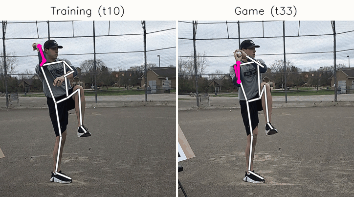

> [!abstract] Summary
> This was originally meant to be Markerless 2.2, but my standard procedural review led to a full pose model switch. This changed the October session's
> elbow varus from +2.2 SD to about average/modestly above (−0.2 to +1.1 SD) for my velo. Going forward, smaller weekly process tweaks will live in the [Session Log](https://ryanliam-bio.github.io/baseball_analytics/projects/pitching-session-log/), 
> while full-scale pipeline or process changes will be detailed in separate writeups like this one.

### Overview

Where [2.1](https://ryanliam-bio.github.io/baseball_analytics/projects/opensim-v2/) focused on second-camera sync, 3.0 gives us more reliable numbers and improved processing via a better pose model, manually annotated 
event timing, and automatic detection of problematic clips before they go through the pipeline. I try to do something of a holistic process review every time I draft a project update; 
this time around it led me down the rabbit hole of alternative pose models. All analysis thus far had used some form of Google's MediaPipe.

However, MediaPipe continued to struggle on multiple levels, most notably with peak elbow torque climbing alongside tested filter cutoffs,
which suggests our previous numbers were inflated by jitter and arm-tracking error. So, I tested OpenMMLab's RTMPose with a YOLOX person detector against 
MediaPipe; below you'll see that RTMPose came out with much cleaner results across the board. We will use it as our default model going forward. 
The resultant elbow varus values are more reliable, and both sanity checks against Driveline's data (table below) now land close. The OpenSim musculoskeletal modeling was unchanged.

In addition, I made a few procedural changes alongside the model switch for our Nov 14 session:
 - A second 240 fps phone camera instead of the iPhone that unevenly kept 162 of 240 frames per second
 - Manually annotated foot plant + release, the latter of which was consistently later than auto-detection
 - Move from tall outfield grass to infield dirt, which simultaneously helped and hurt
 - Addition of a "game delivery" to the "training delivery" I'd been throwing as I develop my feel for pitching again
 - Checks for left/right arm and leg swaps, anchoring each leg to the hip and ensuring peak wrist speed on glove hand does not exceed throwing hand
 - Flashlight as a secondary sync cue (tip from a former mocap partner). 
 Exposure settings were not tuned enough for this to be effective, but the "glowstick" flashlight mode should work much better next time

---

#### A New Challenger Appears: RTMPose

- MediaPipe has been the pose model since 1.0. I ran both the October (2.1) and Nov 14 sessions through RTMPose (extra-large model, body + feet keypoints), details below.
- OpenSim is the full-body estimate; the simpler forearm-and-hand model is there because I can run the exact same model on Driveline's OpenBiomechanics data, which enables direct comparison.

| Check | MediaPipe | RTMPose |
| --- | --- | --- |
| Left/right swaps repaired in the side view, per throw (Nov 14) | 188 | 0 |
| Throws with a trunk jump over 20° (Nov 14) | 2 | 0 |
| Simple-model elbow torque as the filter loosens from 12 to 25 Hz (Nov 14) | 75 → 111 N·m | 70 → 81 N·m |
| Wrist speed at release ÷ ball speed (Oct; Driveline: 0.53–0.55) | 0.65 | 0.56 |
| OpenSim's worst throwing-arm miss in late cocking (Oct) | 7.3 cm | 2.9 cm |
| OpenSim ÷ simple model, session medians (Oct; Driveline published ÷ simple: 1.09) | 1.29 | 1.11 |

- **Takeaways:**
  - Every check favors RTMPose
  - Most informative check is the torque vs filter cutoff: MediaPipe's climbs as the filter loosens (arm jitter feeding the peak); RTMPose is much more consistent
  - From the side view, RTMPose closely follows the blurred, cocked forearm in late cocking; MediaPipe draws the arm already straightening and puts the elbow on the torso
- **Costs / on hold:**
  - RTMPose defines hip points differently, so pelvis rotation and hip-shoulder separation are on hold until checked
  - It puts confident points on joints it can't see, which matters for the lead leg (below)
  - The two models disagree on when and how far max layback (peak shoulder external rotation) happens for the game delivery (~30 ms, ~13°), so the angle is left out for now
  - MediaPipe stays for the one-phone (2.0) mode, though that is not likely to be used again

#### Manually Annotated Events

- **Why:** automatic foot plant and release detection were regularly off by several frames or more, which hurts every timing metric downstream
- **Automatic foot plant:** median miss dropped from ~70 ms under MediaPipe to ~19 ms under RTMPose, but the worst miss was still 131 ms (foot plant to release only takes ~185 ms)
- **Automatic release** (based on side-view wrist speed): consistently ~30 ms early (middle half within ±1.5 ms), so it's correctable by a constant, but manual annotation is used instead
- **Method:** frame by frame in the side view (LosslessCut), with detailed notes on most throws
  - Foot plant = first frame of foot contact with ground
  - Release = last frame the ball touches the fingers
- **Later:** after a few more sessions, I'm hoping to train a better event detector

#### Focus Check

- One side clip (5 throws) was entirely out of focus and went through the whole pipeline unnoticed until I started marking events
- Every clip now gets a sharpness score before processing (that clip: 28 vs ~2,650 for the rest)

#### Calibration and Sync

- **Stereo calibration:** board holds were only ~1 s and the board clip had no clap, so phones couldn't be reliably lined up from the holds
  - Quick fix: scanned time offsets for where the board's pose agrees between phones, then calibrated on 55 synced slow-moving frames. Stereo reprojection error was 1.23 px, board square 107.01 mm (true 107.0)
- **Sync:** clap audio reads ~8.8 ms off the geometric sync (~2 ms sound travel + audio/video lag), so every clip was ultimately pinned to clap + 8.8 ms

#### Left/Right Tracking and the Lead Leg

*Throw 10 (training) vs throw 33 (game) from behind, aligned and paused at foot plant, RTMPose skeleton reprojected from 3D (magenta = throwing arm), 4x slow motion*

- **Left/right labeling:**
  - MediaPipe regularly swaps left and right in one camera; the old frame-by-frame fix left single-frame trunk jumps of 30–125° in 20 of 32 throws
  - Each throw is now labeled two ways (frame by frame, best path over the whole delivery) and the pipeline keeps whichever passes physical checks: no sudden shoulder flips, humanly possible hand speed, throwing hand faster than glove hand, both cameras agree on the throwing arm
  - Trunk jumps: 20 throws originally, cut to 2 with new labeling on MediaPipe, further to 0 on RTMPose (which barely swaps to begin with)
  - Legs now have to stay attached to their own hips (before, they occasionally flipped in the follow-through)
- **Lead leg:**
  - This was the real struggle of my Nov 14 session; I can't confidently take away much of anything about my lower body mechanics
    - The main problem is that the behind camera can't see the lead knee. I believe the infield dirt made it worse: on a gloomy overcast day the pipeline seemed to struggle to separate my legs from the dirt. At least I could mark foot plant more reliably.
  - MediaPipe: the lead knee is obscured by the body from the back view. We only had coverage from both phones on 8% of frames between foot plant and release (on most throws, none at all)
  - We tried filling in based on 2D side view (knee placed along line of sight at measured thigh length) but it was visibly way off and subsequently dropped
  - RTMPose tracks it with a "confident guesses" caveat. Checked against the side view:
    - At release: agrees within ~5°
    - At foot plant (hidden from behind): off by a median 9°, and over 40° on the worst tenth of throws. Not usable.

#### Ball Speed From the Side

- 2.1's two-camera ball fit relies on clean side-view ball tracking. Moving to infield dirt shifted our background to be gray clouds rather than October's treeline, so the ball was not clear throughout. The back view never separates the ball from the hand (October included), so the two-camera fit had nothing to fall back on
- **New method:** track the ball in the side view, take its depth from the triangulated hand, fit the flight with gravity + drag
- **Validation on October session** (two-camera fit as reference): ~1 mph low (give or take ~1), so Nov 14 speeds get +1 mph
- **Nov 14 footage problem:**
  - Shifting the fit window ±8 ms around release moves the same throw's speed by a median 3 mph, up to ~9
  - 10 of 32 throws never gave a clean ball track (one clip lost entirely)
  - October passes the same test (10 of 13 throws stable: at least 3 of 5 shifted fits agree within 2 mph) so this is another casualty of the overcast day
- As a result, Nov 14 gets session-level speeds only; no single-throw numbers

---

### Results

- **October, revised** (rerun on RTMPose):
  - OpenSim (same smoothed-marker setup as 2.1): median elbow varus 97 N·m (95% CI 92–110; plausible range ~80–110 across filter and arm-path choices), was 128; shoulder internal rotation 102 N·m, was 130. Both now in the lower half of Driveline's middle 80% (varus 88–135, IR 83–131)
  - Simple model, adjusted for velocity + size: −0.2 to +1.1 SD across every filter cutoff and arm definition. Previous classification as "higher than typical for my velocity" withdrawn; about average to modestly above
  - Velocity effectively unchanged, 63.5 mph
- **Torque timing** (simple model):
  - 2.1 caveat: peak often landed after max layback (Driveline's lands 8–17 ms before)
  - Nov 14 game delivery: before max layback on 13 of 16 throws (median ~17 ms before, the early edge of Driveline's 8–17 ms); training: 8 of 16 (median 8 ms after)
    - It's worth investigating whether this timing reflects a real difference between deliveries, small-sample noise (13 of 16 vs 8 of 16 isn't statistically significant), or a data quality problem (the game delivery's max layback timing is itself uncertain). October (training delivery) also peaked median 8 ms after max layback.
- **Training vs game:** hand-marked events made a real comparison possible, see [session log](https://ryanliam-bio.github.io/baseball_analytics/projects/pitching-session-log/) for more details

---

### What's Next: 3.1

- Move the behind camera 30–45° toward the glove side, so it sees the lead leg at foot plant instead of RTMPose guessing
- Check RTMPose's hips and max layback (the two things on hold)
- A contrasting band on the lead knee or ankle, giving the tracking something unambiguous to lock onto
- Sync and calibration:
  - Flashlight in glowstick mode where both phones see it (not a beam flashed between them) with exposure tuned for it, plus a clap at the start of the shared-board clip (silly oversight this session)
    - Light has no audio lag. If it works, it replaces the 8.8 ms correction
  - ~3 s per board pose
- Measure the rolling shutter (a flickering light leaves bands that reveal each phone's readout time)
- More sessions of hand marks will hopefully allow me to train a foot plant / release detector
- Background: ideally treeline again, or we may move indoors for the winter. Pretty much anything would be a contrast upgrade over the clouds.

---

### Limitations

- **Hand marks:** one person, one view, no finer than a frame (~4 ms); confidence tagged per throw; a few lean on judgment
- **Lower body:** the lead knee at foot plant is still a guess from behind (the behind camera can't see it); the gloomy day and dirt background likely made lower-body detection harder too, though that wasn't quantified
- **Nov 14 torque:** simple model only, as the T-pose clip didn't triangulate my arms, so OpenSim's body model couldn't be fitted for this session
- **Nov 14 ball speed:** can't rank single throws
- **October, iPhone back view:** 6 throws with a one-frame trunk jump around foot plant or in the follow-through (none inside the torque window)
- 2.1's caveats on the simple model, arm path and two-phone sync still apply (see [2.1's Limitations](https://ryanliam-bio.github.io/baseball_analytics/projects/opensim-v2/#limitations))
- **Rolling shutter:**
  - Phone sensors read out row by row over a few ms, not the whole frame at once
  - Fast things (hand, ball) get caught at slightly different moments depending on where they are in the frame
  - With two phones at different angles, that adds a small, position-dependent sync error, plausibly the same size as the existing 1–2 ms sync error
  - Lab machine-vision cameras use a global shutter (whole frame at once) and very short exposures, a big part of why their tracking is cleaner
  - Readout time isn't measured yet; it's on the 3.1 list
- **Flat ground:**
  - Every session so far has been off flat ground, not a mound
  - Affects stride, lead leg, trunk tilt, and likely velocity
  - Driveline's pitchers all throw off a mound, so every comparison carries an asterisk

---

### Corrections Along the Way

- **Pose model:** all of 2.1 ran on MediaPipe; switching to RTMPose moved October's OpenSim elbow varus from 128 to 97 N·m and withdrew the simple model's +2.2 SD claim
  - 2.1 already noted a stricter filter pulled it toward +1 SD; in hindsight, that was the jitter showing
  - 2.1 now has a note at the top pointing here
- **Out-of-focus clip:** processed with everything else until I noticed it while marking; it's excluded everywhere, and the focus check exists because of it
- **Lead leg:** the first pass filled the hidden lead knee from the side view alone. It looked measurable on nearly every throw, but that fill made up nearly all of the foot plant to release lead-knee data and looked wrong on video, so it's gone
- **Elbow position at foot plant** (shoulder horizontal abduction): first training vs game comparison showed a 57° gap; part of it was tracking glitches; with clean tracking ~48°

---

### Technical Notes

- **Capture:** Galaxy S26 Ultra behind the rubber + Galaxy S23 Ultra side-on from the arm side, both slow motion 1080p at 240 fps; Nov 14, 2026; 42 throws, 37 recorded on both phones over 7 clips + T-pose (the S23 missed one clip); 32 analyzed after excluding a 5-throw out-of-focus clip
- **Pose:** RTMPose-x (Halpe-26: body + feet, no hands) via rtmlib on ONNX Runtime (GPU), with a YOLOX-x person detector run every 10th frame and the crop carried from the previous frame's keypoints otherwise
(keypoints within ~2 px of running the detector every frame). Legacy MediaPipe Pose (complexity 1, as in 1.0/2.0) kept for one-phone mode; 2.1's two-phone runs used MediaPipe PoseLandmarker (heavy)
- **Calibration:** 7×5 ChArUco, 107.0 mm squares; reprojection error 0.26 / 0.24 px (S26 / S23), focal length ±0.32% / ±0.42%. Stereo: 1.23 px, baseline 5.72 m, 77° between cameras
- **Sync:** clap audio cross-correlation + 8.8 ms fixed bias (geometric sync on the two cleanest clips: 8.6 / 9.0 ms)
- **Events:** foot plant and release hand-marked on the side view in LosslessCut; peak knee lift detected from the behind view; max layback = peak shoulder external rotation from foot plant to release + 20 ms
- **Focus check:** median variance of the Laplacian per clip
- **Axes and planes:** X = toward the target, Y = up (fit to the planted feet), Z = my right when facing the target (OpenSim's convention). Trunk forward tilt lives in the sagittal plane (X–Y),
trunk side tilt in the frontal plane (Y–Z), and pelvis/trunk rotation, hip-shoulder separation, and shoulder horizontal abduction in the transverse plane (X–Z)
- **Left/right labeling:** greedy frame-by-frame vs a Viterbi path over the four camera-swap hypotheses, scored on shoulder-line jumps, throwing-wrist peak speed (≤30 m/s, ≥75% of the fastest candidate, and above the glove wrist's), and arm agreement between views;
legs relabeled where they'd otherwise attach to the opposite hip. No one-camera fill
- **Torque:** 2.1's simple model (forearm + hand, 20 Hz, peak 40 ms before to 20 ms after max layback) on the triangulated keypoints with the forearm stretched to my tape length (11⅛ in). OpenSim (2.1's smoothed-marker setup)
rerun on RTMPose for October (ratio of session medians 1.11 × the simple model; per-throw median 1.20 vs Driveline's 1.10); not used for Nov 14 (T-pose didn't triangulate the arms)
- **Ball speed:** side view only; depth from the triangulated wrist at release; flight fit with gravity and drag; +1 mph bias from October. Robustness = refitting with the window shifted −8 to +8 ms around the hand-marked release
- **Overlays:** the saved 3D skeleton reprojected into each view; joints drawn where both phones see them (gaps up to 50 ms bridged, as in the analysis)
- **Software:** Python 3.11, RTMPose / rtmlib, MediaPipe 0.10.14, OpenCV 4.11, PyAV, NumPy, SciPy, pandas, OpenSim 4.6, plus LosslessCut. Code and results tables available on request

 

<em>Questions, comments, etc. welcome- just message me.</em>

