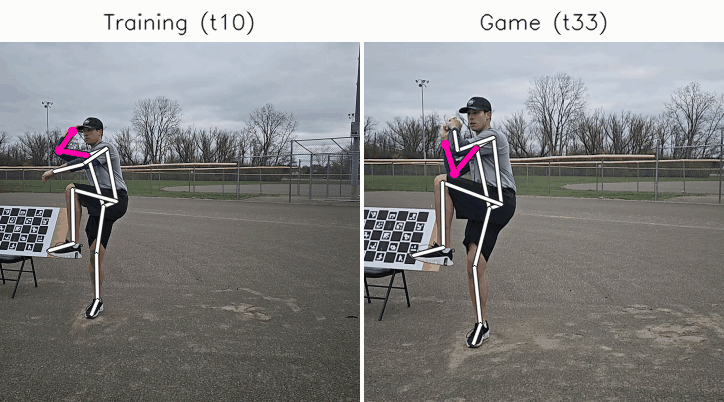

> [!abstract] Summary
> Pipeline changes now get their own page ([3.0](https://ryanliam-bio.github.io/baseball_analytics/projects/opensim-v3/)). This log is the short version of each session: training intent, acquisition setup changes, etc. Newest on top.

## Nov 14, 2026: Training vs. Game Delivery

**Setup**
- Local field, flat ground, ~40°F, overcast; two phones at 240 fps (side and behind)
  - First time throwing off infield dirt (rather than outfield grass)
- 16 training throws and 16 game throws analyzed (42 thrown; a 5-throw clip didn't record on side phone, another 5-throw side clip out of focus)
- ChArUco calibration board visible to both cameras throughout acquisition, in case cameras shift and need an offset anchor

**Intent**
- First session recording a "game delivery" next to the "training delivery"
- **Training:** Built to get arm cocked early and reduce strain previously driven by a woefully inefficient windup.
    - This has been my default as I've worked with a local training center this year to revamp my delivery. I hadn't pitched in 10 years, but
    learned at the end of my time with MSU Football EQ that I didn't know how to throw nearly as well as I thought and was overcompensating with raw 
    arm strength- probably why I've had shoulder/elbow problems on and off for years now. Early cocking allows me to focus on generating power rotationally from
    the ground up, but trying to hold pronation too hard has contributed to a pair of minor biceps strains. The feel takes time.  
    - Defining cues: elbow at shoulder level, wrist cocked/pronated near right ear, start with shoulders/hips turned inwards, push off from heel to toe, 
    get plant foot open, rip glove arm down as trunk uncoils, energy should flow naturally to throwing arm rather than needing to be pulled or yanked towards release, continue trunk tilt through finish
- **Game:** A more natural adaptation of the training delivery cues.
  - Training delivery is great when it works, but timing often feels awkward and it's harder to "find" proper sequencing outside the clinic. This "game delivery"
  is my first effort at finding a smoother implementation of the healthier training cues, bridging the gap between what is correct and what is comfortable.
  Every throw in these sessions is meant to have a single cue in mind, adjusted every 2-3 throws, to develop the feel for timing and space. 
  This is the same way I work my golf game- intentional reps, constantly adjusting goal/environment, trying to continuously improve the process rather than immediately fire top rail fastballs.
  Very much a work in progress here, there's a chance that this "smoother adaptation" is just reinforcing the bad habits we're working to undo. TBD.

*Throw 10 (training) vs throw 33 (game), aligned and paused at foot plant, RTMPose skeleton reprojected from 3D (magenta = throwing arm), 4x slow motion*

**Training vs game** (medians; foot plant and release hand-marked)

| | Training (16) | Game (16) |
| --- | --- | --- |
| Elbow flexion through the windup (peak knee lift to foot plant, average) | 120° | 82° |
| Elbow behind the shoulder line at foot plant (+ = behind) | −9° | +39° |
| Shoulder external rotation at foot plant | 82° | 41° |
| Elbow flexion at foot plant | 112° | 87° |
| Foot plant to release | 179 ms | 194 ms |

*Two game throws are missing windup and elbow-position values; those rows use the remaining 14 game throws.*

- **The difference is primarily in the arm before foot plant:** the game delivery carries a much straighter arm through the windup and lands with the elbow well behind the shoulder line (no overlap between deliveries on either)
  - At foot plant on training throws, the forearm is roughly upright relative to the trunk (82° external rotation); on game throws it's tipped forward, about halfway between pointing forward and upright (41°). The ranges barely overlap (game high 62°, training low 59°)
  - Throw 33 above is one of the more cocked game throws (54°, 3rd highest of 16), so the GIF understates the typical gap. 
    - To the credit of the training delivery, I think this would indicate that I'm not getting my arm up in time for most game throws. Several game throws (3 of 16) don't get the forearm flipped until after foot plant
- **Everything else looked about the same:** tempo to foot plant, foot plant to release (ranges overlap heavily despite the 15 ms gap in medians), trunk tilt and arm slot at release
- **Max layback:** the two pose models disagree on the game delivery so I can't draw meaningful conclusions yet
- **Worth watching:** the last five training throws (after the first game block) reached foot plant with less elbow bend (89–100° vs 110–124° early on). Possibly fatigue, possibly the game delivery bleeding in; regardless, the more relaxed position may ultimately be correct

**My notes from marking video**
- I repeatedly turn my back foot inwards during leg lift by mistake, which generally leads to poor push-off (toes only). Cleats, a real mound, or simply more focus should help
- My front shoulder tends to just "get out of the way" instead of pulling down
- Landing needs a lot of work. Several times I don't get my plant foot over enough, creating too much of a crossfire delivery. Often moving over or around lead leg instead of blocking properly. 

**Elbow load and velocity**
- No clear difference in elbow varus (simple model): 84 N·m for training delivery, 79 for game with intervals overlapping. October session was ~88 N·m. 
  - Simple-model numbers only compare with each other; OpenSim reads ~10% higher (October: 97 N·m on the [3.0 page](https://ryanliam-bio.github.io/baseball_analytics/projects/opensim-v3/#results))
- Ball speed: ~61 mph typical with top throws around 64 (October 63.5); blame it on the cold day and short warmup, not washed and not coping.
  - In seriousness, the background degraded the [velo estimation](https://ryanliam-bio.github.io/baseball_analytics/projects/opensim-v3/#ball-speed-from-the-side) enough 
  that I can't confidently rank single throws or say one delivery was faster than the other

**After the session**
- Distal biceps flare-up just like my mid-summer strain. Thankfully this one doesn't seem as bad 5 days later, but holding pronation too strongly
throughout delivery is a no-no that I need to remember going forward.

**Next Up**
- Get back to the throwing clinic once my arm is 100% recovered, try to put the pieces together again
- Trial indoor acquisition at a family friend's pole barn batting cage. This will certainly present new capture challenges but it beats throwing in snow.

---

<em>Questions, comments, etc. welcome- just message me.</em>

